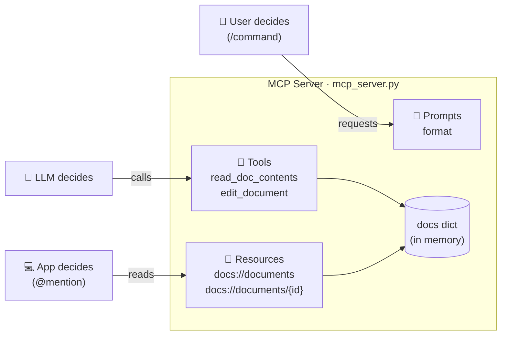
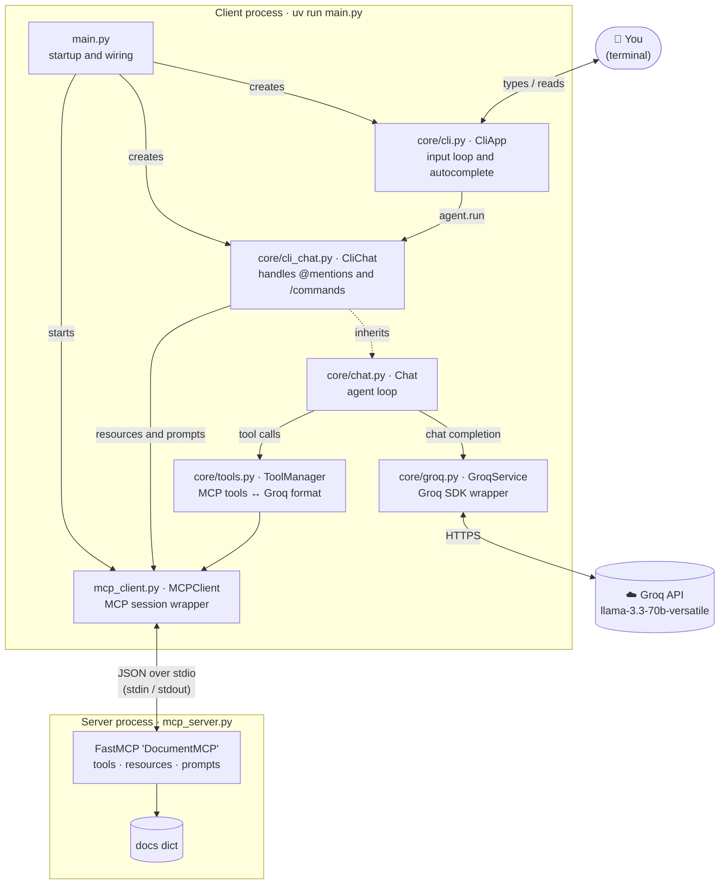
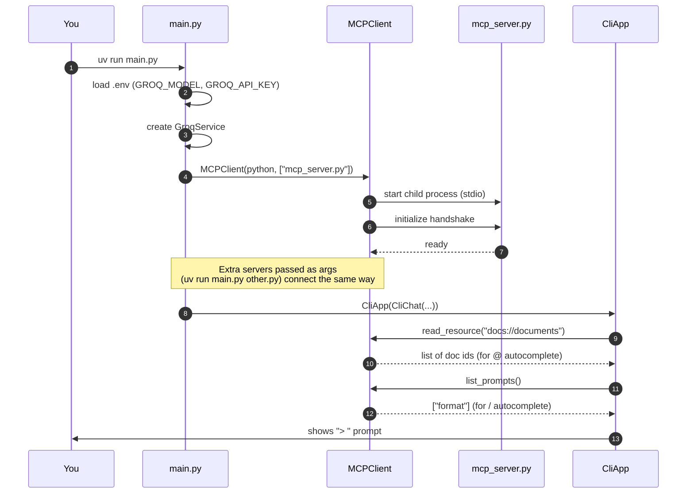
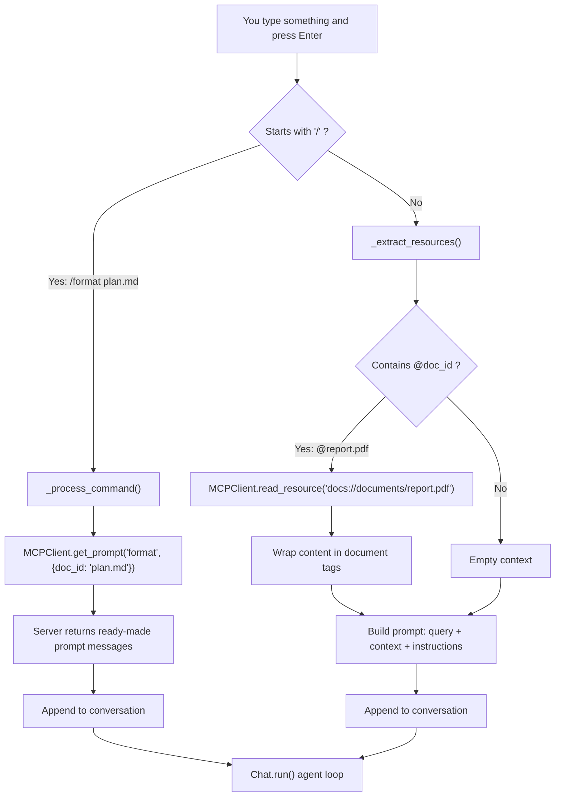
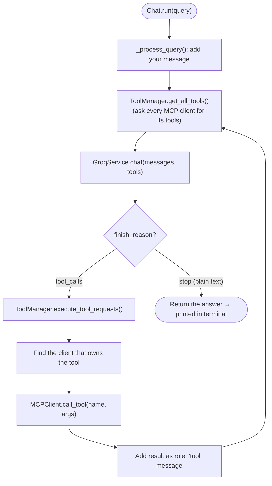
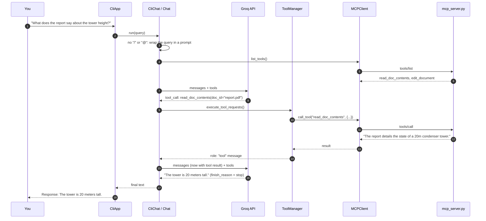
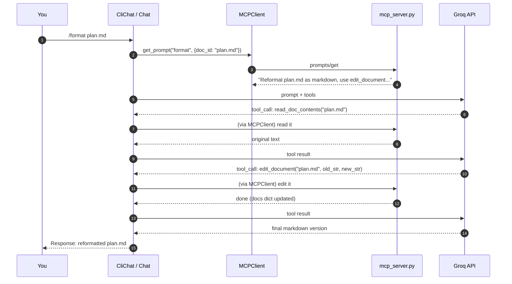
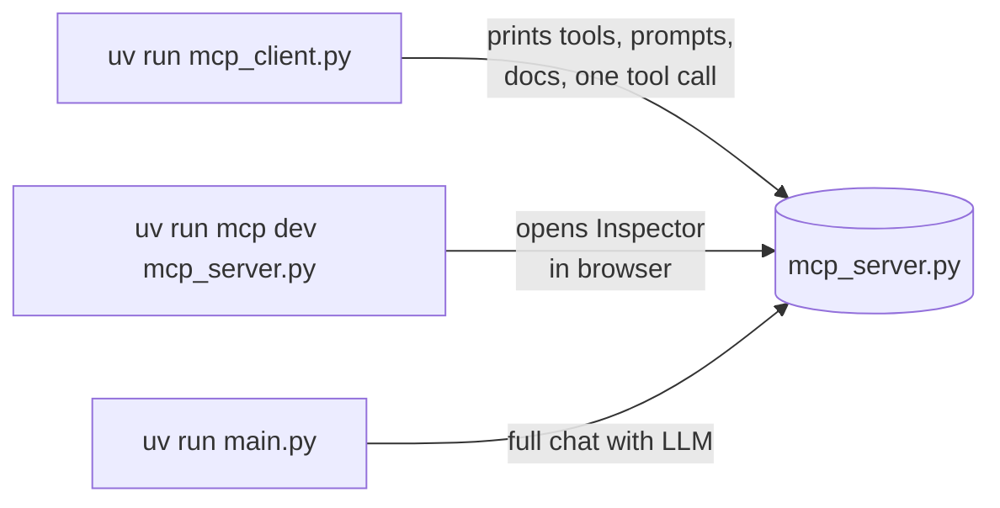

# MCP Chat

A command-line chat app that connects a Groq-hosted LLM (Llama 3.3 by default) to a set of documents through the **Model Context Protocol (MCP)**.

You type questions in the terminal. The LLM answers, and when it needs to, it **reads or edits documents by calling tools** on an MCP server. You can also attach documents with `@doc_id` and run server-defined prompts with `/command`.

The project is a small, complete example of the three building blocks of MCP: **tools**, **resources** and **prompts**.

---

## Table of contents

- [What is MCP?](#what-is-mcp)
- [Architecture at a glance](#architecture-at-a-glance)
- [Project structure](#project-structure)
- [How the code flows](#how-the-code-flows)
- [Setup](#setup)
- [Usage](#usage)
- [Testing the server](#testing-the-server)
- [Extending the project](#extending-the-project)
- [Troubleshooting](#troubleshooting)

---

## What is MCP?

**MCP (Model Context Protocol)** is a standard way for an AI application to connect to outside data and actions. It splits the work into two sides:

- An **MCP server** offers capabilities: "here are my tools, my data and my prompt templates."
- An **MCP client**, which lives inside the AI app, connects to the server and uses those capabilities.

In this project the server is `mcp_server.py` and the client is `mcp_client.py`. They talk over **stdio**: the client starts the server as a child process and exchanges JSON messages through its stdin and stdout.

The server offers three kinds of capability. The key difference is **who decides when each one is used**:

| MCP primitive | In this project | Who controls it | How it's triggered |
|---|---|---|---|
| **Tool** | `read_doc_contents`, `edit_document` | The **LLM** | The model decides to call it while answering |
| **Resource** | `docs://documents`, `docs://documents/{doc_id}` | The **app** | The app fetches it when you type `@report.pdf` |
| **Prompt** | `format` | The **user** | You run `/format plan.md` |



---

## Architecture at a glance



There are **two separate processes**. `main.py` starts `mcp_server.py` automatically, so you never need to run the server yourself.

---

## Project structure

```
cli_project_COMPLETE/
├── main.py            # Entry point: loads .env, starts MCP server(s), runs the CLI
├── mcp_server.py      # MCP server: documents + tools, resources, prompts
├── mcp_client.py      # MCP client wrapper (list/call tools, prompts, resources)
├── core/
│   ├── cli.py         # Terminal UI (prompt_toolkit): input loop, Tab-completion
│   ├── cli_chat.py    # Turns @mentions into context and /commands into prompts
│   ├── chat.py        # Agent loop: LLM → tool calls → LLM → ... → answer
│   ├── tools.py       # Converts MCP tools to Groq format, routes tool calls
│   └── groq.py        # Thin wrapper around the Groq SDK
├── pyproject.toml     # Project metadata and dependencies
├── uv.lock            # Exact pinned versions (used by uv)
└── .env               # Your API key and model (NOT committed)
```

| File | Role | Key pieces |
|---|---|---|
| `main.py` | Wires everything together | `main()`, `AsyncExitStack`, `USE_UV` switch |
| `mcp_server.py` | Owns the data and capabilities | `@mcp.tool`, `@mcp.resource`, `@mcp.prompt` |
| `mcp_client.py` | Talks MCP to a server | `connect()`, `list_tools()`, `call_tool()`, `get_prompt()`, `read_resource()` |
| `core/cli.py` | What you see and type into | `CliApp.run()`, `UnifiedCompleter` |
| `core/cli_chat.py` | Pre-processes your input | `_process_query()`, `_extract_resources()`, `_process_command()` |
| `core/chat.py` | The agent loop | `Chat.run()` |
| `core/tools.py` | Glue between LLM and MCP tools | `get_all_tools()`, `execute_tool_requests()` |
| `core/groq.py` | Calls the LLM | `GroqService.chat()` |

---

## How the code flows

### 1. Startup: `uv run main.py`



### 2. What happens to what you type

`CliChat._process_query()` checks your input first and builds the message for the LLM:



### 3. The agent loop (`Chat.run`)

This loop is how the LLM "uses tools". It keeps going until the model answers in plain text.



### 4. Full example: a question that needs a tool

> `> What does the report say about the tower height?`



### 5. Full example: a `/format` command

> `> /format plan.md`



### Why everything is `async`

Talking to the MCP server means waiting on pipes, and waiting for keyboard input is also slow I/O. The MCP SDK is **async-only**, so every function that uses it is `async def`, all the way up to `asyncio.run(main())` in `main.py`. This lets the server connections keep running in the background while the app waits for you to type.

> Note: `GroqService.chat()` uses the **synchronous** Groq client, so the app pauses while waiting for the LLM. That's fine for a single-user CLI.

---

## Setup

### Prerequisites

- Python 3.10+
- A [Groq API key](https://console.groq.com/keys)
- [uv](https://github.com/astral-sh/uv) (recommended), or plain `pip`
- Node.js (only needed for the MCP Inspector)

### Step 1: Configure environment variables

Copy `.env.example` to `.env` in the project root and fill in your key:

```
GROQ_API_KEY="your-groq-api-key"
GROQ_MODEL="llama-3.3-70b-versatile"
USE_UV=0
```

| Variable | Meaning |
|---|---|
| `GROQ_API_KEY` | Your Groq API key (required) |
| `GROQ_MODEL` | Any Groq model that supports tool calling (required) |
| `USE_UV` | `1` = start MCP servers with `uv run`, `0` = start them with the current Python (default) |

> `.env` is listed in `.gitignore`. Never commit your API key.

### Step 2: Install and run

#### Option 1: with uv (recommended)

**uv** is a fast all-in-one replacement for `pip`, `venv` and `poetry`. `uv run` creates the virtual environment, installs the dependencies from `uv.lock`, and runs the script, all in one step.

```bash
pip install uv
uv run main.py
```

#### Option 2: without uv

```bash
python -m venv .venv
# Windows: .venv\Scripts\activate    macOS/Linux: source .venv/bin/activate
pip install groq python-dotenv prompt-toolkit "mcp[cli]>=1.8.0,<2.0.0"
python main.py
```

> Keep the quotes around `"mcp[cli]>=1.8.0,<2.0.0"`. Without them, the shell treats `>` as "redirect to a file".

---

## Usage

| What you type | What happens |
|---|---|
| `What is in the report?` | Normal chat. The LLM may call `read_doc_contents` by itself |
| `Tell me about @deposition.md` | The app fetches the document (a resource) and puts it in the prompt |
| `/format plan.md` | Runs the server's `format` prompt. The LLM rewrites the doc as Markdown using `edit_document` |
| `Tab` | Autocompletes `/commands` and `@doc_ids` |
| `Ctrl+C` | Quit |

Available documents: `deposition.md`, `report.pdf`, `financials.docx`, `outlook.pdf`, `plan.md`, `spec.txt`.

> Documents live **in memory**. Edits are lost when the app exits.

Connect extra MCP servers by passing their scripts as arguments:

```bash
uv run main.py other_server.py
```

---

## Testing the server

There are three ways to check the server, from quickest to most interactive:



### Quick client test

```bash
uv run mcp_client.py
```

Expected output:

```
Tools: ['read_doc_contents', 'edit_document']
Prompts: ['format']
Docs: ['deposition.md', 'report.pdf', 'financials.docx', 'outlook.pdf', 'plan.md', 'spec.txt']
report.pdf: The report details the state of a 20m condenser tower.
```

### MCP Inspector (web page for testing by hand)

```bash
uv run mcp dev mcp_server.py
```

| Part | What it does |
|---|---|
| `uv run` | Runs the command inside the project's virtual environment |
| `mcp` | CLI tool from the `mcp[cli]` package |
| `dev` | Starts your server with the Inspector connected |
| **Inspector** | Web page (needs Node.js, launched through `npx`) for calling tools, reading resources and trying prompts, with **no LLM involved** |

Open the URL printed in the terminal (including the `MCP_PROXY_AUTH_TOKEN` part) and click **Connect**. The Inspector starts its **own copy** of the server, so its edits are separate from the running CLI.

> Running `uv run mcp_server.py` directly shows nothing. The server waits silently for a client on stdin. Press `Ctrl+C` to stop it.

---

## Extending the project

**Add a document:** add an entry to the `docs` dict in `mcp_server.py`.

**Add a tool** (the LLM can call it):

```python
@mcp.tool(name="count_words", description="Count the words in a document.")
def count_words(doc_id: str = Field(description="Id of the document")):
    return len(docs[doc_id].split())
```

**Add a prompt** (shows up as a `/command`):

```python
@mcp.prompt(name="summarize", description="Summarize a document.")
def summarize(doc_id: str = Field(description="Id of the document")) -> list[base.Message]:
    return [base.UserMessage(f"Read {doc_id} with read_doc_contents and summarize it in 3 bullet points.")]
```

Restart the app. The new tool and prompt are discovered automatically, with no client changes needed.

---

## Troubleshooting

| Problem | Fix |
|---|---|
| `AssertionError: GROQ_MODEL cannot be empty` | Fill in `.env` (see [Setup](#step-1-configure-environment-variables)) |
| `ValueError: I/O operation on closed pipe` on exit (Windows) | Harmless shutdown warning: asyncio closed before the pipes did. Fixed in `mcp_client.py` with a short `await asyncio.sleep(0.1)` after the client closes |
| `uv run mcp_client.py` prints nothing | Make sure you have the latest `mcp_client.py`. It prints tools, prompts and docs |
| `npx: command not found` with `mcp dev` | Install Node.js and open a new terminal |
| Model doesn't call tools | Use a Groq model that supports tool calling (e.g. `llama-3.3-70b-versatile`) |
